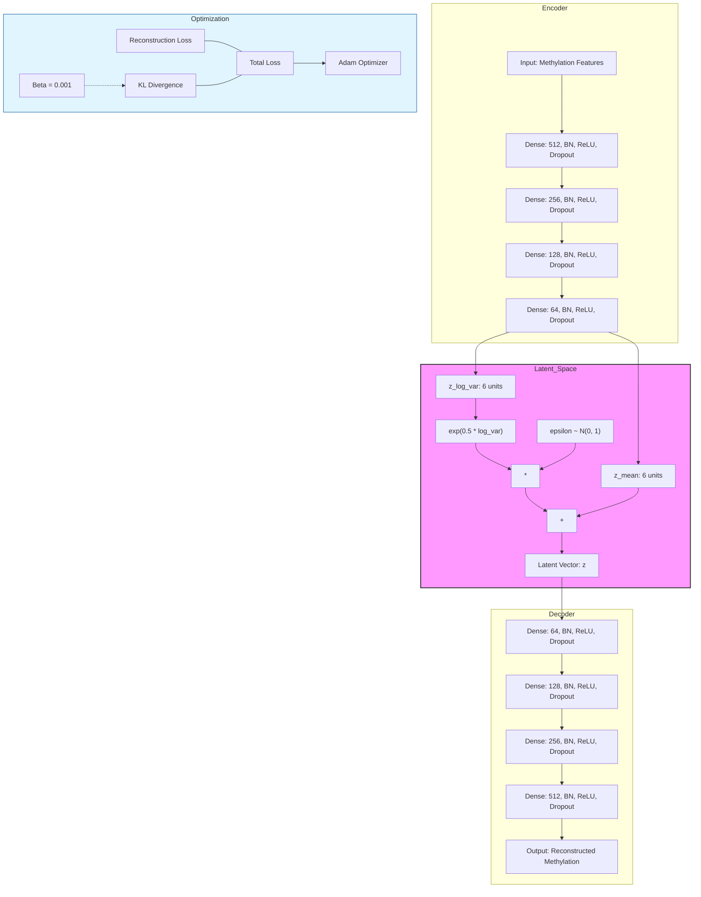

# Regularized Variational Autoencoder (VAE) Architecture

This document describes the implementation of the regularized VAE used for biological signal discovery in methylation data.

## Architecture Diagram

## Graph Legend & Implementation Details

### 1. Neural Network Layers
- **Dense Layers:** Fully connected layers with decreasing units (512, 256, 128, 64) in the encoder and symmetric units in the decoder.
- **BN (Batch Normalization):** Applied after each dense layer to stabilize training and accelerate convergence.
- **ReLU:** Rectified Linear Unit activation function for non-linearity.
- **Dropout (0.05 - 0.1):** Light dropout for regularization, preventing overfitting while preserving signal.

### 2. Probabilistic Framework
- **Latent Dimension (6D):** A compressed representation of the input methylation data.
- **z_mean & z_log_var:** The encoder outputs parameters of a Gaussian distribution rather than a single point.
- **Reparameterization Trick:** Enables backpropagation through the stochastic sampling process by defining $z = \mu + \sigma \cdot \epsilon$.

### 3. Regularization & Training
- **Beta ($\beta = 0.001$):** A hyperparameter that weights the KL Divergence relative to the Reconstruction Loss. This controlled weighting (part of the $\beta$-VAE framework) ensures a balanced latent space.
- **Thresholding (8 & 7):** Input features are selected based on OLS association significance thresholds ($-\log_{10}(p) \ge 7$ and $\ge 8$).
- **Cross-Validation:** 5-fold stratified cross-validation is used to ensure the robustness of the latent embeddings.
- **Optimization:** Adam optimizer with 150 epochs and early stopping (patience = 40).

### 4. Implementation Stack
- **Framework:** Keras 3 with TensorFlow backend.
- **Environment:** R (via `reticulate`) with GPU acceleration enabled.

---

## VAE Implementation Specification

### 1. Prompt Structure
The VAE implementation is designed to transform high-dimensional methylation data into a low-dimensional, biologically relevant latent space. The process involves:
1. **Feature Selection:** Identifying CpGs based on significance thresholds.
2. **Model Training:** Using a regularized probabilistic framework.
3. **Embedding Extraction:** Generating 6-dimensional coordinates for downstream analysis.

### 2. Input Parameters
- **Thresholds:** `c(7, 8)` (Selection of CpGs with $-\log_{10}(p) \ge 7$ or $8$).
- **Beta ($\beta$):** `0.001` (Weight for KL Divergence).
- **Latent Dimension:** `6`.
- **Cross-Validation:** `5-fold` stratified.
- **Training Hyperparameters:** `Batch Size = 256`, `Epochs = 150`, `Patience = 40`.

### 3. Output Format
- **Models:** **Not persisted.** Each fold's model is used to extract `z_mean` and then discarded —
  `VAE/lite/01_vae_embedding.qmd` has no `save_model*` call.
- **Embeddings:** Averaged latent coordinates across CV folds, written to
  `VAE/lite/output/embedding_threshold_{7,8}.rds` (`.rds` only; no `.csv`).
- **Plots:** Training history (loss/val_loss) and latent space visualizations.

### 4. Success Metrics
- **Reconstruction Accuracy:** Low mean squared error (MSE) between input and output.
- **KL Divergence Stability:** KL loss should converge and not collapse to zero.
- **Biological Relevance:** Latent dimensions should correlate with known phenotypes (e.g., dementia status).
- **CV Robustness:** Consistent embedding patterns across different folds.

### 5. Error Handling
- **GPU Memory:** Implementation of `TF_FORCE_GPU_ALLOW_GROWTH` to prevent allocation failures.
- **Convergence Issues:** Early stopping with significant patience (40 epochs) to handle training plateaus.
- **Data Integrity:** Stratified sampling in CV to ensure consistent class representation (if applicable).

### 6. Version Control
- **Implementation:** `VAE/lite/01_vae_embedding.qmd` — the live pipeline, which defines no `VERSION`
  constant. The earlier versioned implementation (`VERSION <- "1.0.0"`) is
  so its `vae_N` are not the manuscript's latent axes.
- **Deterministic Operations:** `tf.config.experimental.enable_op_determinism()` enabled for reproducibility.
- **Seeds:** Fixed random seeds (123) for R and TensorFlow; per-fold `123 + fold_idx`.

> **This is not aspirational — it holds.** A full retrain on 2026-07-16 reproduced the 2026-06-03 fit
> **bit-for-bit** (all 4 embeddings and all 38 downstream `.rds` hashed identical). Re-running the
> pipeline on unchanged data does not move the figures; only a change to the **input** or the
